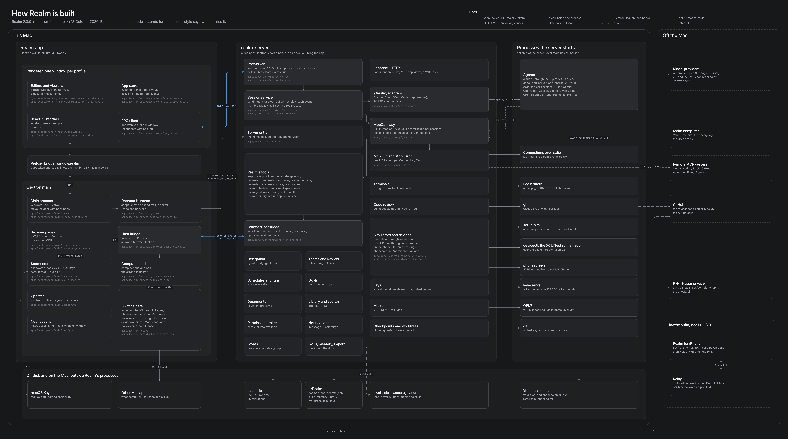
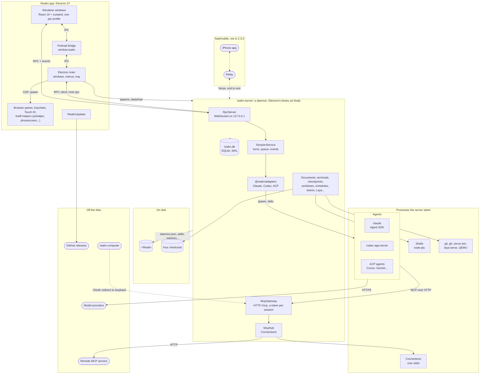
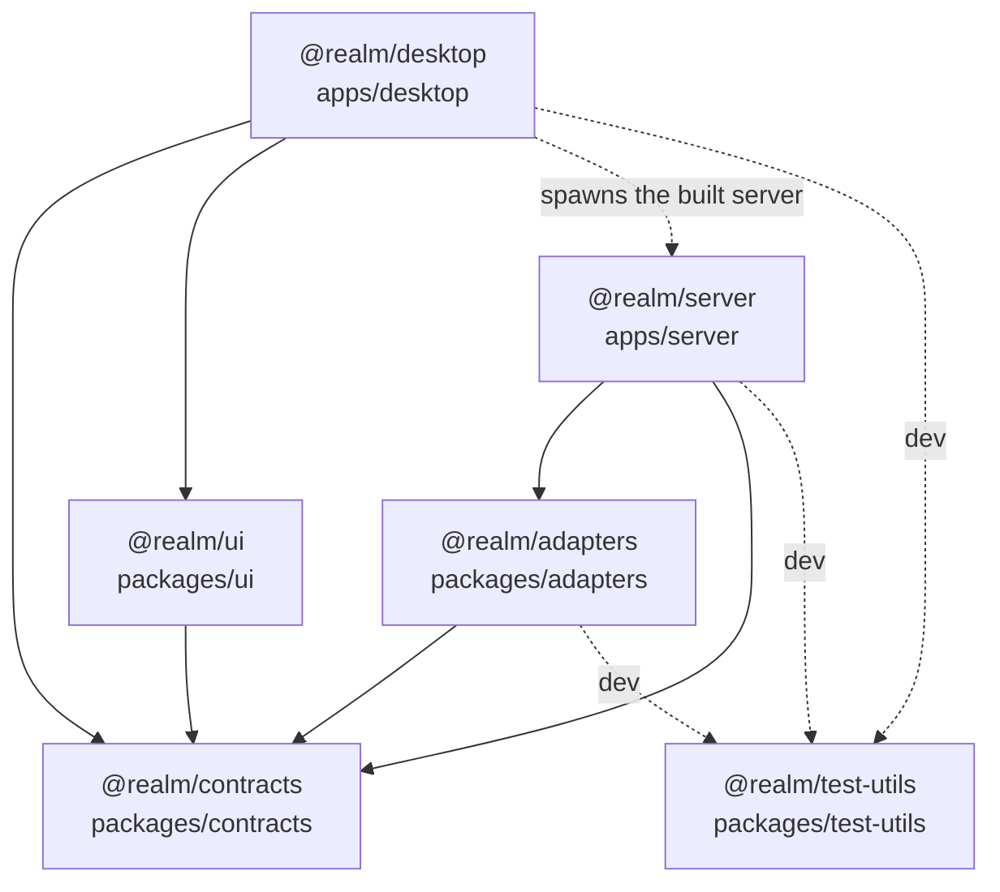
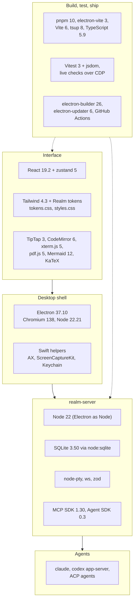

# How Realm is built

Realm is two processes on your Mac, plus the agents they start. The app you see is an Electron app.
Everything that has to outlive a window (sessions, terminals, schedules, the database) lives in a
second process, `realm-server`, which in the packaged Mac app keeps running after you quit. The two
talk over one local WebSocket. The agents are separate processes again, and they reach Realm's tools
through one local MCP endpoint.

This page is the map. [features.md](features.md) follows each feature through it.

*Open [`realm-architecture.html`](realm-architecture.html) in a browser for the version you can pan
and zoom; click a box for the files it stands for. It is one file and fetches nothing.*

What you will find here:

- [The whole system](#the-whole-system), as one drawing, and [the lines between processes](#the-lines-between-processes)
- [Where the code lives](#where-the-code-lives): every package, what it owns and who depends on whom
- [The tech stack](#the-tech-stack), layer by layer, with the versions in the lockfile

## The whole system

Read it top to bottom. The renderer is React with no Node in it (context isolation is on); it reaches
Electron main only through the preload bridge, and it reaches the server directly over the RPC socket. Main starts the
server, owns everything native (browser views, the Keychain, Touch ID, the Swift helpers) and is
itself a client of the same socket, so the server can ask it to drive a page or another app. The
server owns all state and starts the agents. The agents talk to their own providers; Realm never sits
between an agent and its model.

### The lines between processes

| From | To | Over | Where |
|---|---|---|---|
| Electron main | realm-server | `spawn(process.execPath, [entry])` with `ELECTRON_RUN_AS_NODE=1`, detached, so it outlives the app | `apps/desktop/src/main/server-process.ts:spawnDaemon` |
| realm-server | Electron main | port and token written to `~/Realm/daemon.json` (mode 0600), read back by main | `apps/server/src/daemon/state.ts:writeState`, `apps/desktop/src/main/daemon-state.ts:readDaemonState` |
| Electron main | renderer | `--realm-port`, `--realm-token` arguments, exposed as `window.realm` | `apps/desktop/src/preload/index.ts` |
| renderer | realm-server | WebSocket on `127.0.0.1`, subprotocol `realm.<token>`; calls one way, `RpcServer.broadcast` events back | `apps/desktop/src/renderer/src/rpc/client.ts:RpcClient`, `apps/server/src/rpc/server.ts:RpcServer` |
| renderer | Electron main | `ipcRenderer.invoke` through the preload, for windows, browser panes, files, passwords and updates | `apps/desktop/src/preload/index.ts` |
| Electron main | realm-server | a long-lived RPC client of its own, which registers as the host | `apps/desktop/src/main/browser-agent-bridge.ts:startBrowserAgentBridge` |
| realm-server | Electron main | a targeted `browserHost.op` event, answered by `browserHost.result` | `apps/server/src/browsers/host-bridge.ts:BrowserHostBridge` |
| Electron main | browser panes, its own window | the DevTools Protocol through `webContents.debugger` | `apps/desktop/src/main/browser-agent-host.ts:BrowserAgentHost`, `apps/desktop/src/main/app-drive.ts:AppDriveHost` |
| Electron main | Swift helpers | spawn; `axhelper` takes one JSON line per request on stdin | `apps/desktop/src/main/computer-use-helper.ts:ComputerUseHelper` |
| realm-server | agents | spawn, stdio: the Agent SDK for Claude, JSON-RPC for Codex and ACP | `packages/adapters/src/claude/claude-adapter.ts:ClaudeAdapter`, `packages/adapters/src/jsonrpc/stdio.ts:StdioJsonRpc` |
| agents | realm-server | MCP over HTTP at `127.0.0.1:<port>/mcp`, a bearer token per session | `apps/server/src/mcp/gateway.ts:McpGateway` |
| realm-server | Connections | MCP over stdio, Streamable HTTP or SSE, one client per server | `apps/server/src/mcp/hub.ts:McpHub` |
| realm-server | realm.db | `node:sqlite`, WAL, foreign keys on, 56 migrations | `apps/server/src/db/database.ts:openDatabase`, `apps/server/src/db/migrations.ts:migrations` |
| realm-server | documents pane | a loopback HTTP preview server with a per-boot token and a strict CSP | `apps/server/src/documents/preview.ts:DocumentPreviewServer` |

The server listens on loopback only, on five ports the OS picks at boot: the RPC socket (pinned with
`REALM_PORT` if you set it), the MCP gateway, the document preview server, the server that frames the
views an MCP app ships (`apps/server/src/apps/server.ts:AppViewServer`), and a VNC relay for machine
panes (`apps/server/src/app.ts:createApp`). In a packaged Mac build the server is a daemon: ⌘Q leaves it
running with your sessions and terminals, and only the tray's Quit Realm & stop agents ends it.
In development it is a child of the app.

### What is on disk

Everything Realm keeps is under `~/Realm` (or `REALM_HOME`), except your code, which stays where it is.

| Path | What it is |
|---|---|
| `realm.db` | every profile, space, session, event, schedule, run and setting |
| `daemon.json`, `daemon.lock` | the running server's port, token and pid, and the lock that keeps it to one |
| `secrets.json` | saved passwords and passkeys, and the keys that seal OAuth tokens in `realm.db`; its keyring is sealed by `safeStorage`, and only Electron main opens it |
| `logs/server.log`, `logs/credential-audit.log` | the daemon's output, and one line per password fill (never the value) |
| `skills/`, `.cache/skills/` | the skill library, and the per-space stage of symlinks a session is handed |
| `memory/` | one Markdown memory per space and per profile, plus imported memories |
| `library/<profileId>/` | files you added to the Library by hand |
| `worktrees/<spaceId>/<slug>` | the git worktrees Realm made |
| `laya/` | Laya's Python venv, checkpoints, recordings and `decisions.jsonl` |
| `tmp/attachments/` | pasted attachments, swept after a day |

## Where the code lives

A pnpm workspace of two apps and four packages, read from their `package.json` files. The desktop
app does not import the server: it spawns the server's built output (`apps/server/dist/main.js`) as a
process, which is why there is no arrow between them.

| Package | What it owns | Depends on | Used by |
|---|---|---|---|
| `@realm/desktop` (`apps/desktop`) | The Electron app: main (`src/main`), preload (`src/preload`) and the React renderer (`src/renderer`), the Swift helpers (`native/`), packaging | contracts, ui | nobody; it is the app |
| `@realm/server` (`apps/server`) | realm-server: RPC, sessions, the MCP gateway and hub, every service and store, the SQLite schema | adapters, contracts | started as a process by desktop |
| `@realm/adapters` (`packages/adapters`) | One adapter per agent protocol (Claude, Codex, ACP, Fake), JSON-RPC over stdio, spawning across platforms | contracts | server |
| `@realm/contracts` (`packages/contracts`) | Every shape that crosses a process: zod schemas, the RPC method and event catalog, session events, layouts, platform capabilities | zod, ulid | everything |
| `@realm/ui` (`packages/ui`) | Icons (Hugeicons), theme derivation, the accent fill solver, Realmites | contracts | desktop |
| `@realm/test-utils` (`packages/test-utils`) | Shared test helpers | vitest | every package's tests |

Outside the workspace:

| Folder | What it is |
|---|---|
| `site/` | realm.computer, a Next.js app with its own lockfile, deployed to Vercel (see `site/README.md`) |
| `skills/` | the skills that ship with the app, each copied into `~/Realm/skills` once |
| `resources/` | the icon's source drawing, the iPhone test runner (`ios-device-runner`) and Laya's training script and benchmark |
| `scripts/` | release, local install and daemon tools (`pnpm release`, `pnpm app:update`, `pnpm daemon:status`) |
| `apps/desktop/scripts/` | build, packaging and notarizing, plus the `*-live.mjs` checks that drive the built app |
| `tools/` | `seal-egg-packs.mjs`, which seals the easter-egg packs |
| `docs/` | design specs and plans (`docs/superpowers/`), developer notes (`docs/dev/`), the platform and password notes, and this map |

## The tech stack

Versions are the ones `pnpm-lock.yaml` resolves today (and `site/pnpm-lock.yaml` for the site); the
Electron, Chromium, Node and SQLite versions were read from the Electron binary itself.

| Layer | What | Version | Where it is used |
|---|---|---|---|
| Languages | TypeScript | 5.9.3 | everything in the workspace and the site |
| | Swift | system `swiftc` | the six helpers in `apps/desktop/native/`, the iPhone test runner |
| | Python | 3.10 to 3.14, arm64 | Laya's runtime and training, in its own venv |
| Desktop | Electron | 37.10.3 (Chromium 138.0.7204.251, Node 22.21.1) | the app, and the server's runtime |
| | electron-builder, @electron/notarize | 26.15.3, 2.5.0 | packaging, signing and notarizing |
| | electron-updater | 6.8.9 | updates from GitHub releases, signed builds only |
| Interface | React, react-dom | 19.2.8 | the renderer |
| | zustand | 5.0.15 | the app store (`state/store.ts`) |
| | react-resizable-panels | 3.0.6 | splits |
| | Hugeicons (`@hugeicons/react`, `@hugeicons-pro/core-stroke-rounded`, or `@hugeicons/core-free-icons` without the Pro token) | 1.1.9, 1.2.1, 1.2.1 | every icon, through `packages/ui` |
| Styling | Tailwind CSS (`@tailwindcss/vite`) | 4.3.3 | utility layer under Realm's own tokens |
| | Realm tokens | in repo | `theme/tokens.css`, `styles.css`, `packages/ui/src/themes.ts` |
| | shadow-plugin | 2.1.0 | layered shadow stacks |
| | Inter, JetBrains Mono | bundled woff2 | interface and code type |
| Editors and viewers | TipTap | 3.31.0 | rich documents |
| | CodeMirror | 6 (`@codemirror/view` 6.43.11) | code |
| | react-datasheet-grid, papaparse, fast-formula-parser | 4.11.6, 5.7.0, 1.0.19 | sheets and formulas |
| | pdf.js (`pdfjs-dist`) | 5.7.284 | PDFs, in the renderer and for text on the server |
| | xterm.js (`@xterm/xterm`), `@xterm/headless` | 5.5.0 | terminals on screen, and the screen an agent reads |
| | Mermaid, KaTeX, highlight.js | 12.1.0, 0.16.47, 11.12.0 | diagrams, math and code in the transcript |
| | marked, markdown-it, DOMPurify | 18.0.9, 15.0.1, 3.4.13 | Markdown in the transcript and documents, sanitised |
| | noVNC | 1.7.0 | machine panes |
| Server | Node (Electron as Node) | 22.21.1, in development too (`REALM_NODE` picks another) | realm-server |
| | SQLite (`node:sqlite`) | 3.50.4 | `realm.db`, WAL, FTS5 for search |
| | ws | 8.21.3 | the RPC socket |
| | zod, ulid | 3.25.76, 2.4.0 | every schema and id in `@realm/contracts` |
| | node-pty | 1.2.0-beta.15 | terminals |
| | `@modelcontextprotocol/sdk` | 1.30.0 | the gateway and the hub |
| | `@anthropic-ai/claude-agent-sdk` | 0.3.281 | Claude sessions |
| | vis-network | 9.1.13 | served to graph previews |
| Build | pnpm | 10.21.0 | the workspace |
| | electron-vite, Vite, `@vitejs/plugin-react` | 3.1.0, 6.4.3, 4.7.0 | main, preload and renderer bundles |
| | tsup | 8.5.1 | the server bundle (`dist/main.js`) |
| | tsx | 4.23.12 | the server's live-check scripts |
| Tests | Vitest | 3.2.7 | every package (`vitest.config.ts` projects) |
| | jsdom, Testing Library | 25.0.1, 16.3.2 | renderer components |
| | `*-live.mjs` scripts | in repo | the built app, driven over CDP |
| CI | GitHub Actions | `build-desktop.yml` | typecheck, test and unsigned packages on macOS, Linux and Windows |
| Site | Next.js, React | 16.3.4, 19.2.8 | realm.computer |
| | Tailwind CSS | 4.3.3 | the site's styles |
| | vgpu | 0.3.1 | the WebGPU field behind the landing page |
| | Vercel | | hosting |
| Mobile (`feat/mobile`) | SwiftUI, CryptoKit | iOS 26 | the iPhone app and RealmKit |
| | Cloudflare Workers, Durable Objects | | the relay |
| | `@realm/remote` | | Noise and frames on the Mac side, over `node:crypto` |

## Checking this map

The map is only worth anything while it matches the code. Two scripts keep it honest:

- `node docs/architecture/check-citations.mjs` fails on any cited file or symbol that no longer
  exists, in these pages and in the poster's boxes. The mobile section's paths are read from
  `origin/feat/mobile`, so fetch that branch first.
- `apps/desktop/node_modules/.bin/electron docs/architecture/render.mjs` draws every Mermaid block
  with the Mermaid the app ships, fails on one that does not parse, and redraws the poster's PNG.
  Add `--blocks <folder>` to get each drawing as a PNG to look at.

The poster's boxes live in `realm-architecture.html` as plain data (`REGIONS`, `NODES`, `EDGES`),
each node with its files, so moving a box or adding one is an edit to a list.
