# How each feature works

This is the second half of the [architecture map](README.md). The map shows the processes and the
lines between them; this page follows one feature at a time through them. Every section has a
drawing, a short account of what happens, and the files to open first.

Paths are from the repo root and read `path:Symbol`. Two names come up everywhere, so here they are
once:

- **The RPC socket.** The renderer, Electron main and the scripts all talk to realm-server over one
  WebSocket on `127.0.0.1`, authenticated by the subprotocol `realm.<token>`
  (`apps/server/src/rpc/server.ts:RpcServer`). Calls go one way; the server pushes events to every
  client with `RpcServer.broadcast`.
- **The gateway.** Realm hands every agent exactly one MCP server, `realm`, at
  `http://127.0.0.1:<port>/mcp` with a bearer token minted for that session
  (`apps/server/src/mcp/gateway.ts:McpGateway.register`). Realm's own tools and every Connection
  the space has switched on are behind it.

When the server needs Electron to do something only Electron can (drive a web page, click in another
app, open the Keychain) it sends a `browserHost.op` event down main's own RPC socket and waits for
`browserHost.result` (`apps/server/src/browsers/host-bridge.ts:BrowserHostBridge`). That one reverse
channel carries every feature below that touches a native view.

## Contents

1. [A turn, from the prompter to the transcript](#a-turn-from-the-prompter-to-the-transcript)
2. [Permission prompts and modes](#permission-prompts-and-modes)
3. [Sub-agents and delegation](#sub-agents-and-delegation)
4. [Teams, roles and Review](#teams-roles-and-review)
5. [Scheduled tasks, runs and goals](#scheduled-tasks-runs-and-goals)
6. [The browser pane, the browser agent and saved passwords](#the-browser-pane-the-browser-agent-and-saved-passwords)
7. [Documents and the Library](#documents-and-the-library)
8. [Terminals](#terminals)
9. [Checkpoints, restore and fork](#checkpoints-restore-and-fork)
10. [Code review](#code-review)
11. [Spaces, worktrees and environments](#spaces-worktrees-and-environments)
12. [Connections](#connections)
13. [Skills](#skills)
14. [Computer use and Laya](#computer-use-and-laya)
15. [Simulators and devices](#simulators-and-devices)
16. [Notifications and Needs you](#notifications-and-needs-you)
17. [Mobile](#mobile)
18. [Updates and releases](#updates-and-releases)

## A turn, from the prompter to the transcript

You press Return in the prompter and the store sends `sessions.send` over the RPC socket. If a turn is
already running, the message either waits for it to settle (queue, the default) or is steered in:
Codex takes it into the running turn, and every other agent is interrupted first. Otherwise it starts
a turn now.
A turn starts by taking a checkpoint of the checkout, then making sure the agent process is live:
that is where the adapter is picked, the gateway token is minted and the skills and memory are
handed over. From then on the adapter turns whatever its agent prints into Realm's own event union.
Each event is persisted to `session_events` and broadcast as `session.event`; the renderer folds it
into the transcript. Streaming text (`assistant_delta`) is broadcast but never stored, so a reload
shows the settled message instead.

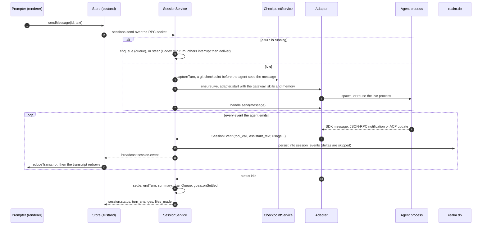

The adapter interface is small: `start()` returns a handle with an `events` async iterable and
`send`, `respondPermission`, `interrupt`, `setOptions` and `dispose`. Claude runs through the Agent
SDK's `query()` in streaming-input mode, which spawns the `claude` binary Realm ships; Codex shares
one `codex app-server` process across sessions and speaks JSON-RPC to it over stdio; each ACP agent
(Cursor, Gemini, OpenCode, Copilot, goose, Qwen Code, Grok, DeepSeek, OpenHands, fx, Hermes) is one
process per session speaking the Agent Client Protocol. The title is set from the first message at
once and upgraded by a model call in the background.

**Key files**

- `apps/desktop/src/renderer/src/state/store.ts:sendMessage`, `applySessionEvent`, `flushSessionDeltas`
- `apps/desktop/src/renderer/src/panes/session/transcript-model.ts:reduceTranscript`
- `apps/server/src/sessions/service.ts:SessionService.send`, `enqueue`, `deliver`, `ensureLive`, `onEvent`, `drainQueue`
- `packages/contracts/src/presets.ts:AGENT_MIDTURN_DELIVERY`, `resolveMidTurnMode`
- `packages/contracts/src/session-events.ts:SessionEventSchema`, `PERSISTED_EVENT_TYPES`
- `packages/adapters/src/types.ts:AgentAdapter`, `AgentHandle`
- `packages/adapters/src/claude/claude-adapter.ts:ClaudeAdapter`, `packages/adapters/src/codex/codex-adapter.ts:CodexAdapter`, `packages/adapters/src/acp/acp-adapter.ts:AcpAdapter`
- `apps/server/src/app.ts:defaultAdapters` (the registry of agent kinds)

## Permission prompts and modes

A session has a permission rung (Ask each time, Accept edits, Full access) and a mode (Build, Plan,
Ask). Both travel on one `permissionMode` field, and each adapter translates it into what its agent
understands. When the agent wants to do something the rung does not cover, the adapter raises a
`permission_request` event, flips the session to `waiting_permission`, and parks a resolver. The card
is drawn from the event like any other transcript row, and Needs you in the sidebar is every session
in that status. Your answer goes back as `sessions.respondPermission` to the same resolver.

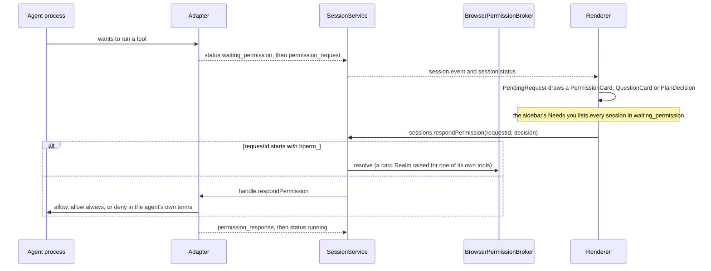

| Rung or mode | Claude | Codex | ACP agents |
|---|---|---|---|
| Ask each time (`default`) | SDK `default` | `on-request`, `workspace-write` | no rung picker: the agent asks in its own terms |
| Accept edits | SDK `acceptEdits` | `on-request`, `workspace-write` | no rung picker |
| Full access (`bypassPermissions`) | SDK `bypassPermissions` | `never`, `danger-full-access` | only for scheduled and team runs: Realm picks the agent's allow option |
| Plan | SDK `plan` | `untrusted`, `read-only` | `session/set_mode` to the agent's plan mode |
| Ask (read only) | SDK `default`, with `canUseTool` refusing anything that is not read-only | `never`, `read-only` | `session/set_mode` to the agent's ask mode |

ACP agents get no rung picker because their mode ids are their own (Cursor's are `agent`, `plan` and
`ask`), and none of them means "how freely may it act".

Realm's own tools have a second gate. A mutating browser, computer or simulator tool passes through
`BrowserPermissionBroker.gate`, which raises the same kind of card with a `bperm_` id. Some of those
cards are drawn even under Full access (`alwaysPrompt` for a generated password, `promptUnderBypass`
for driving another app or filling a saved password). The space's Seatbelt sandbox is a separate
layer again: it wraps the spawn, not the permission.

**Key files**

- `packages/contracts/src/presets.ts:PERMISSION_MODES`, `SESSION_MODES`, `AGENT_SUPPORTS_PERMISSION_MODES`
- `packages/adapters/src/claude/claude-adapter.ts:claudeSdkPermissionMode`, `packages/adapters/src/codex/codex-adapter.ts:codexPolicyFor`, `packages/adapters/src/acp/acp-adapter.ts:acpModeFor`
- `apps/server/src/sessions/service.ts:SessionService.respondPermission`, `markStaleOnBoot`
- `apps/server/src/browsers/permissions.ts:BrowserPermissionBroker`
- `apps/desktop/src/renderer/src/panes/session/PendingRequest.tsx`, `apps/desktop/src/renderer/src/components/sidebar/NeedsYou.tsx:NeedsYou`

## Sub-agents and delegation

A sub-agent is an ordinary Realm session with a parent. The lead agent calls `agent_start` (or
`agent_run`, which starts and waits in one call) through the gateway's `realm-agent` tools. The
server checks depth and capacity (four children per parent, twelve in all), picks the model and
checkout, and sets the child's permission to the lower of the parent's and the one asked for. The
child is created with `dispatchedBy` pointing at the parent and sent its goal as a normal message, so
it runs the turn above. A watcher polls the child's events until it settles or runs out of time;
`agent_wait` then hands the lead the child's last answer, fenced so it reads as a report and not as
instructions.

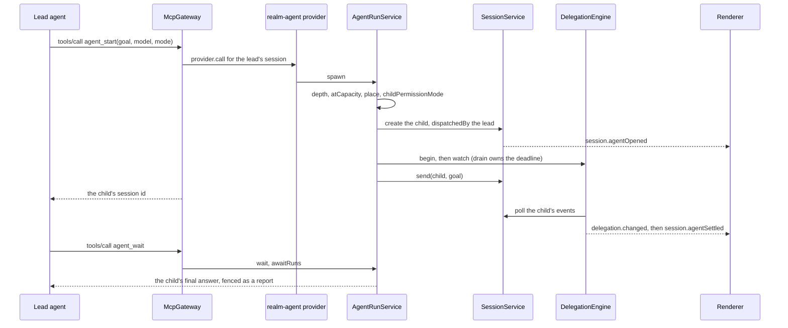

The lead's Agents tab lists its children from `delegation.children` and opens one in the
`SubagentViewer`, where its own permission cards are answered with the same
`sessions.respondPermission` call, pointed at the child. Interrupting the lead interrupts every
child.

**Key files**

- `apps/server/src/browsers/browser-agent.ts:createRealmAgentProvider`
- `apps/server/src/delegation/agent-run.ts:AgentRunService`
- `apps/server/src/delegation/engine.ts:DelegationEngine`, `MAX_RUNS_PER_PARENT`, `MAX_RUNS_TOTAL`
- `apps/server/src/delegation/dispatch.ts:childPermissionMode`
- `apps/server/src/delegation/children.ts:DelegatedChildren`
- `apps/desktop/src/renderer/src/panes/agents-tab/AgentsTab.tsx:AgentsTab`, `apps/desktop/src/renderer/src/panes/agents-tab/SubagentViewer.tsx:SubagentViewer`

## Teams, roles and Review

A team is a space with at least one role. A role is a saved agent: a brief, an agent and model,
skills, a clock and its budgets. The team code never starts a session itself. A role is woken by its
schedule, by Run now, by a handoff or mention, or by your answer in Review, and every wake becomes a
run. A run is admitted only if it fits (one per role, two per team, three unattended across Realm)
and is dispatched into a session in Full access, with the team's policies enforced at the gateway
instead of by cards. The role hands work back with `review_submit`, which lands in Review. Approving
records what you approved and issues a ticket per outward act; requesting changes or rejecting wakes
the role again in its own session.

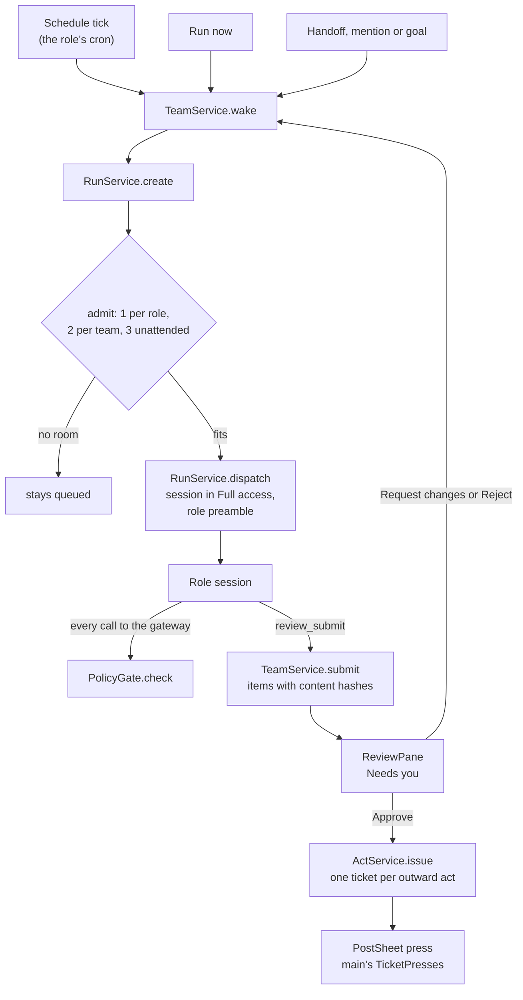

Posting is gated twice: the ticket exists only after approval, and the act happens only when you
press it in the post sheet, which asks Electron main over the host bridge. The adapter that would
post outward is `NotConnectedAdapter` in 2.3.0, so that last step is built up to the press and no
further.

**Key files**

- `packages/contracts/src/team.ts:TeamRoleSchema`
- `apps/server/src/team/service.ts:TeamService` (`wake`, `admit`, `submit`, `approve`, `requestChanges`, `reject`)
- `apps/server/src/runs/service.ts:RunService`, `runPermissionMode`
- `apps/server/src/team/policies/gate.ts:PolicyGate`
- `apps/server/src/team/acts/service.ts:ActService`, `apps/server/src/team/acts/adapters.ts:NotConnectedAdapter`
- `apps/desktop/src/renderer/src/panes/team/ReviewPane.tsx:ReviewPane`, `apps/desktop/src/renderer/src/panes/team/TeamPages.tsx:TeamPage`

## Scheduled tasks, runs and goals

A schedule is a row with a cron or a single time. Once a minute the server claims every schedule
that is due with a compare-and-set on `next_run_at`, so two ticks can never fire the same occurrence.
A recurring task more than six hours late is recorded as skipped rather than run; a one-shot always
fires. Firing creates a run, and the run creates or resumes the session and sends the task, in Full
access because nobody is there to answer a card. The result lands under its task on the Scheduled
page, unread until you open it, and never opens a pane on its own.

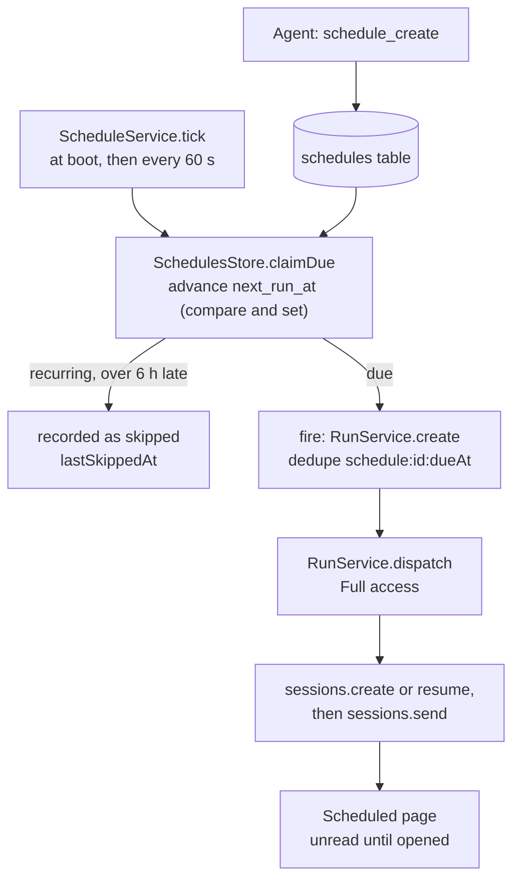

A run is the durable half: a goal that owns a session across attempts, recovered after a restart
without spending an attempt. Goals are a third thing again, a per-session loop: when a turn settles,
`GoalService.onSettled` may send the next continuation prompt itself, until the agent marks the goal
done or blocked, the budget runs out, or it stalls three times. Nothing keeps the Mac awake for an
upcoming schedule; a missed minute is picked up by the next tick inside the six-hour window.

**Key files**

- `apps/server/src/schedules/service.ts:ScheduleService`
- `packages/contracts/src/schedules.ts:SCHEDULE_TICK_MS`, `SCHEDULE_CATCHUP_MS`
- `apps/server/src/store/schedules.ts:SchedulesStore`
- `apps/server/src/schedules/agent-tools.ts:createSchedule`
- `apps/server/src/runs/service.ts:RunService`, `recoverOnBoot`
- `apps/server/src/goals/service.ts:GoalService`
- `apps/desktop/src/renderer/src/panes/schedules/SchedulesPage.tsx`

## The browser pane, the browser agent and saved passwords

A browser pane is a `WebContentsView` that Electron main lays over the window, one partition per
profile. The renderer draws an empty placeholder and reports its rectangle every frame; main moves
the view to match. The view is native, so it composites above the DOM, and the pane's own chrome is
drawn around it rather than over it.

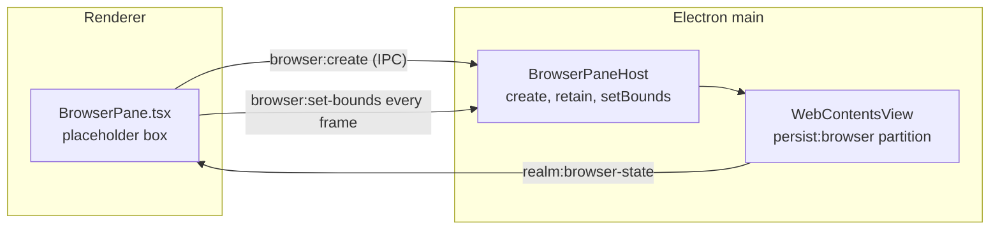

An agent drives the same view through the `realm-browser` tools. Reading (`browser_snapshot`,
`browser_read`, `browser_screenshot`) needs no card. Acting goes through the broker's gate, then
across the host bridge to main, which drives the page with the DevTools Protocol through
`webContents.debugger`. There is no remote debugging port.

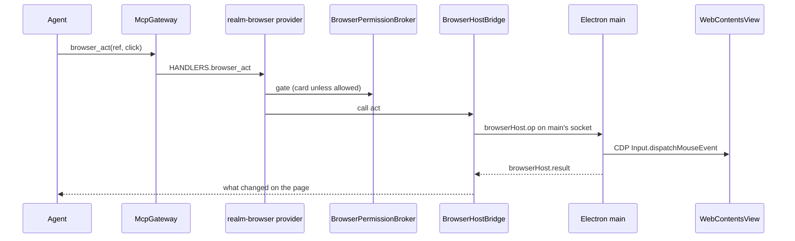

`browser_agent_run` is not a second model loop. It starts a child session that may use only the
`realm-browser` tools, on the origins and act budget it was given, and the parent waits on it
through the same `DelegationEngine` as `agent_run`.

Saved passwords never leave Electron main. The store is a file whose keys are sealed by
`safeStorage` (the login Keychain). An agent can ask Realm to fill one, never to read one, and the
fill passes three gates in this order: a card naming the origin and account (asked even in Full
access, unless you allowed that site), an exact origin check against the live page over CDP, and your
presence (Touch ID by default; Settings can let one confirmation cover a minute or five). Only then is
the value unsealed and typed into the focused field as key events, and the outcome is written to
`logs/credential-audit.log`.

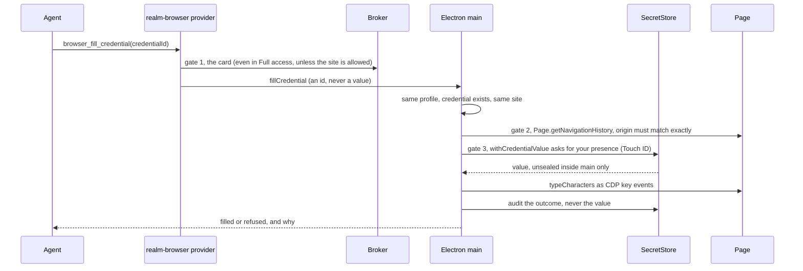

**Key files**

- `apps/desktop/src/main/browser-pane.ts:electronViewFactory`, `createBrowserPane`
- `apps/desktop/src/main/browser-host.ts:BrowserPaneHost`
- `apps/desktop/src/renderer/src/panes/browser/BrowserPane.tsx`
- `apps/server/src/browsers/agent-tools.ts:createBrowserAgentProvider`
- `apps/desktop/src/main/browser-agent-host.ts:BrowserAgentHost`, `apps/desktop/src/main/browser-agent.ts:buildSnapshot`, `performAct`, `performFillCredential`
- `apps/server/src/browsers/browser-agent.ts:BrowserAgentService`
- `apps/desktop/src/main/secret-store.ts:SecretStore`, `apps/desktop/src/main/passwords-ipc.ts:registerPasswordsIpc`

## Documents and the Library

Documents are files in the space's checkout, not copies under `~/Realm`. The documents pane reads
and writes them over RPC, and every write carries the hash it was based on, so a file that changed
underneath you is a conflict instead of a silent overwrite. While a file is open, the server watches
its folder with `node:fs` `watch` and tells the pane when the content hash changes, ignoring the echo
of Realm's own save. HTML guides, PDFs and other previews are served by a small loopback HTTP server
with a strict CSP, and what has no editor is rendered by Quick Look.

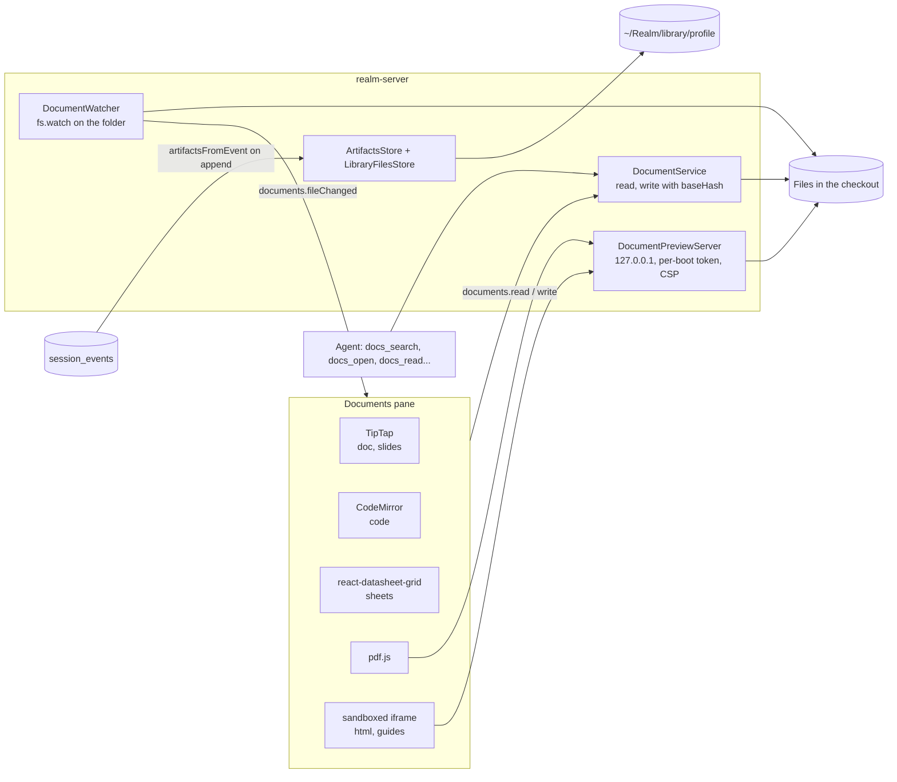

The Library is an index, not a folder. Every event an agent writes a file in, and every attachment,
becomes an `artifacts` row at the moment the event is stored (with a backfill for older history).
Files you add by hand are copied into `~/Realm/library/<profileId>/` and listed beside them. Agents
edit documents with their own write tools; the `realm-docs` tools are for finding, opening and
reading.

**Key files**

- `apps/server/src/documents/service.ts:DocumentService`
- `apps/server/src/documents/watcher.ts:DocumentWatcher`
- `apps/server/src/documents/preview.ts:DocumentPreviewServer`, `GUIDE_CSP`
- `apps/server/src/documents/agent-tools.ts:createDocsAgentProvider`
- `apps/server/src/store/artifacts.ts:ArtifactsStore`, `apps/server/src/store/library-files.ts:LibraryFilesStore`
- `packages/contracts/src/library.ts:artifactsFromEvent`, `packages/contracts/src/documents.ts:documentKindFor`
- `apps/desktop/src/renderer/src/panes/library/LibraryPage.tsx:LibraryPage`

## Terminals

A terminal is a `node-pty` login shell owned by the server, not by the window. Its output goes into
an in-memory ring (128K characters) and out to every window as `terminal.data`, which one xterm.js
instance per terminal writes to the screen. A window that reconnects asks for what it missed by run
and sequence number. In the packaged Mac app the server outlives the window, so shells keep running
after you quit. If the server itself restarts, each terminal comes back as a fresh shell in the same
folder, with its last screen if you turned on terminal history (off by default).

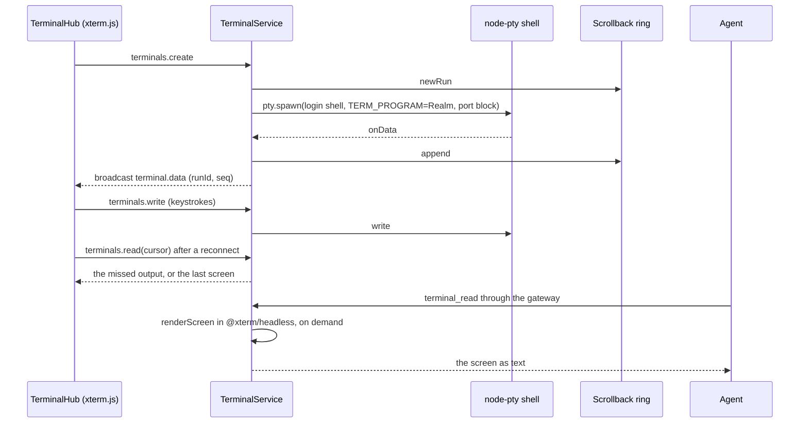

**Key files**

- `apps/server/src/terminals/service.ts:TerminalService`, `HISTORY_FLUSH_MS`
- `packages/contracts/src/terminals.ts:TERMINALS_HISTORY_DEFAULT`
- `apps/server/src/terminals/manager.ts:TerminalManager`
- `apps/server/src/terminals/scrollback.ts:Scrollback`, `RING_CHARS`
- `apps/server/src/terminals/screen.ts:renderScreen`
- `apps/server/src/terminals/agent-tools.ts:createTerminalAgentProvider`
- `apps/desktop/src/renderer/src/panes/terminal-hub.ts:TerminalHub`

## Checkpoints, restore and fork

Before an agent sees your message, the server snapshots the checkout into hidden git refs in the
repository itself, under `refs/realm/checkpoints/<environmentId>/<checkpointId>`. It copies the real
index to a temporary one, writes one tree for what was staged and one for everything on disk
(untracked files included), and commits the second with `HEAD` and a commit of the first as its
parents. Your branch, index and reflog are untouched. Each checkout keeps the last 50.

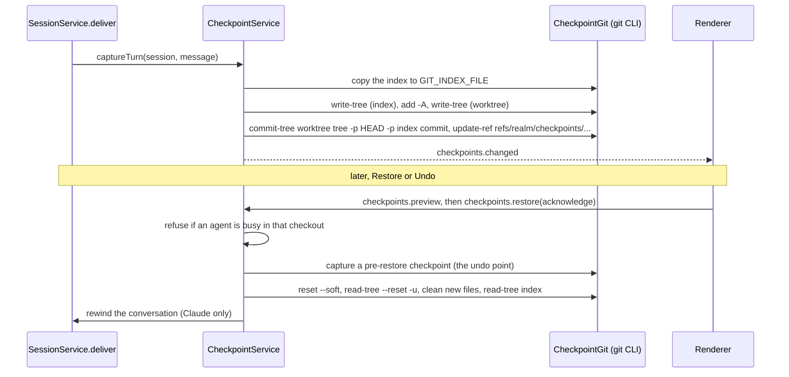

Undo on a turn is the same restore, offered only when nothing after that turn edited files. Fork goes
the other way: it makes a new worktree, writes the checkpoint's trees into it, and starts a session
there with the parent's transcript as context, leaving the original session and checkout alone.

**Key files**

- `apps/server/src/checkpoints/service.ts:CheckpointService` (`captureTurn`, `restore`, `rewind`), `MAX_CHECKPOINTS_PER_ENVIRONMENT`
- `apps/server/src/workspace/checkpoints.ts:CheckpointGit`, `CHECKPOINT_REF_PREFIX`
- `apps/server/src/sessions/fork.ts:ForkService`
- `apps/desktop/src/renderer/src/panes/session/turn-edits.ts:undoOffer`

## Code review

Code review reads GitHub through your own `gh` login; Realm stores no GitHub token. The page lists
pull requests with a GraphQL search, and opening one fetches its details, files and patches with
`gh pr view` and `gh api`. Asking for a review starts a Claude or Codex session in Plan mode with the
diff in the prompt (marked as untrusted text), waits for it, and reads one fenced `realm-review` JSON
block out of its answer. Each comment is checked against the diff's real lines, and nothing reaches
GitHub until you submit, which checks again that the head has not moved.

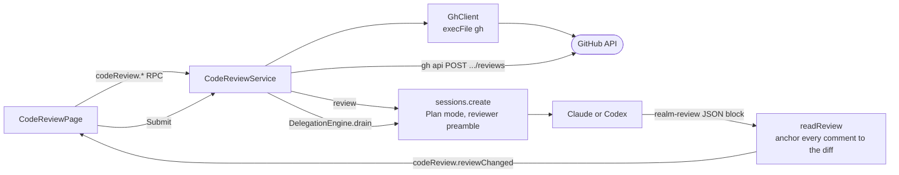

**Key files**

- `apps/server/src/code-review/service.ts:CodeReviewService`
- `apps/server/src/code-review/gh.ts:GhClient`, `ghRunner`
- `apps/server/src/code-review/reviewer.ts:reviewPrompt`, `readReview`
- `apps/desktop/src/renderer/src/panes/code-review/CodeReviewPage.tsx`

## Spaces, worktrees and environments

A profile holds spaces; a space is one body of work with a folder, its pane layout and its groups; an
environment is one checkout of that folder (the primary checkout, another checkout, or a worktree);
a session runs in one environment, and several sessions can share one. A new worktree is made by the
server with `git worktree add` under `~/Realm/worktrees/<spaceId>/<slug>` on a `realm/` branch,
which is renamed from the session's title once it has one. Every environment gets a block of ten
ports from 41000 up, handed to its terminals and agents as `REALM_PORT_BASE`, `REALM_PORT_COUNT` and
`REALM_PORT_END`, so two checkouts of one app never fight over a port.

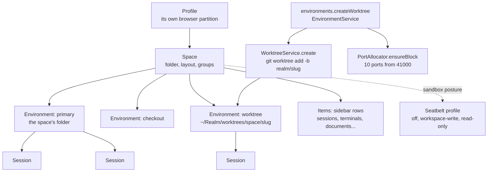

The layout of a space is saved on the space row (`layout_json`, `groups_json`) every time it
changes, so a relaunch puts every pane back. A space can wrap its agents and terminals in a macOS
Seatbelt profile; it is off by default, and when it is on, the spawn is wrapped in `sandbox-exec`.

**Key files**

- `packages/contracts/src/entities.ts:ProfileSchema`, `SpaceSchema`, `EnvironmentSchema`, `SessionSchema`
- `apps/server/src/environments/service.ts:EnvironmentService.createWorktree`
- `apps/server/src/workspace/worktrees.ts:WorktreeService`
- `apps/server/src/workspace/ports.ts:PortAllocator`, `portEnv`
- `apps/server/src/sessions/service.ts:SessionService.resolveEnvironment`
- `apps/server/src/sandbox/spawn-wrap.ts:sandboxWrapFor`, `apps/server/src/sandbox/profile.ts:compileSeatbeltProfile`
- `packages/contracts/src/layout.ts`, `packages/contracts/src/groups.ts`

## Connections

Connections belong to a space, not to an agent. Every session gets the one gateway entry, and the
gateway's tool list is Realm's own providers plus every server the space has switched on, each tool
prefixed with its server's name. A call to a Connection goes to `McpHub`, which keeps one MCP client
per server across all sessions (stdio, Streamable HTTP or SSE) and adds its credentials on the way
out. The agent sees the tools and never the token. Every call, refused ones included, is logged to
`mcp_call_log` and shown in Activity.

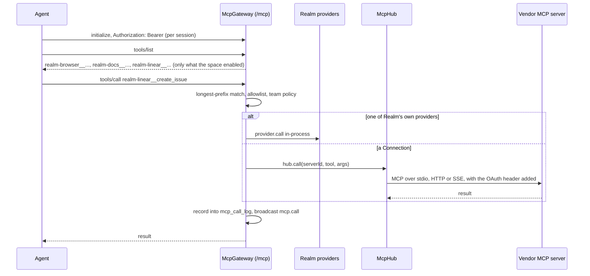

Signing in to a Connection is OAuth with dynamic client registration where the vendor allows it
(GitHub instead takes your `gh` login, a device code or a pasted token). The browser comes back to the gateway's own `/oauth/callback` on loopback, or, for vendors that refuse a
loopback redirect, through `realm.computer/oauth/callback`, which only bounces to
`http://127.0.0.1:<port>/oauth/callback`. Tokens are sealed with AES-256-GCM under a key that
Electron main hands the server from the Keychain-backed secret store.

**Key files**

- `apps/server/src/mcp/gateway.ts:McpGateway` (`register`, `handleMcp`, `handleCall`, `record`)
- `apps/server/src/mcp/hub.ts:McpHub`
- `apps/server/src/mcp/oauth.ts:McpOauth`, `oauthSecretBox`
- `apps/server/src/mcp/service.ts:McpService`
- `packages/contracts/src/connectors.ts:CONNECTORS`, `OAUTH_RELAY_URL`
- `site/app/oauth/callback/route.ts:GET`
- `apps/desktop/src/renderer/src/panes/connections/ConnectionsPage.tsx`

## Skills

Skills live in `~/Realm/skills`. On boot the server copies the skills bundled with the app into that
folder once each, and it also discovers skills in the CLIs' own folders (`~/.claude/skills`,
`~/.codex/skills` and so on) and in the project, which you switch on per space. When a session starts,
the server rebuilds a small stage folder of symlinks to the skills that are on for that space and
hands it to the agent in its own way.

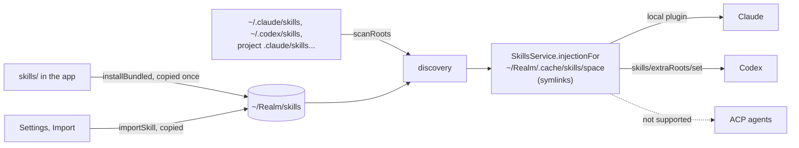

**Key files**

- `apps/server/src/skills/service.ts:SkillsService` (`installBundled`, `injectionFor`)
- `apps/server/src/skills/discovery.ts:scanRoots`
- `packages/contracts/src/skills.ts:AGENT_SKILL_SUPPORT`
- `apps/server/src/import/service.ts:ImportService`
- `skills/` (the five that ship: browsing, ios-simulator, lecture-notes, mac, study-guide)

## Computer use and Laya

Computer use lets an agent read and click in another Mac app. It always starts from a snapshot the
same session took, so an act names an element the agent has seen. The server checks the target is
allowed, raises a card that is asked even in Full access (unless you have allowed that app), and
sends the act across the host bridge.
Electron main shows the "driving" indicator in the menu bar and passes the act as one line of JSON to
`axhelper`, a small Swift program that walks the accessibility tree, brings the app to the front,
refuses secure fields and anything covered by another window, and posts the click or keystrokes.

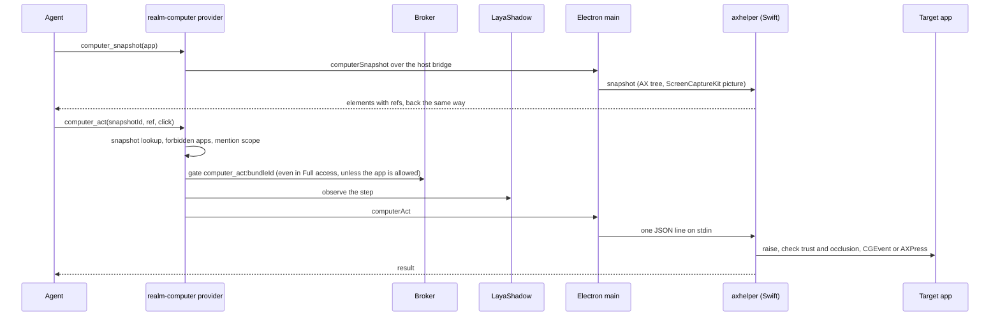

Laya is a small open-weight decision model that Realm runs on your Mac beside these steps. It is not
the agent's model. The server installs it into a Python venv under `~/Realm/laya` and runs
`laya-serve` on loopback with a per-start key. In Shadow (the default) it only listens: browser,
computer and simulator steps are queued to it and its answers go to a decision log. In Assist it may
resolve a target described in words, only once its measured accuracy clears 95% and never for a
step it flags as sensitive. "Record my use of this app" keeps the shape of each simulator screen for
training; `resources/laya/train.py` trains a new checkpoint from those recordings, the decision log
and its benchmark, in the same venv.

**Key files**

- `apps/server/src/computer/agent-tools.ts:createComputerAgentProvider`
- `apps/desktop/src/main/computer-use-host.ts:ComputerUseHost`, `apps/desktop/src/main/computer-use-helper.ts:ComputerUseHelper`
- `apps/desktop/native/AxHelper.swift`
- `apps/server/src/laya/service.ts:LayaService`, `LAYA_DEFAULT_MODE`
- `apps/server/src/laya/runtime.ts:realLayaRuntime`, `apps/server/src/laya/client.ts:LayaClient`
- `apps/server/src/laya/shadow.ts:LayaShadow`, `apps/server/src/laya/assist.ts:createLayaAssist`, `apps/server/src/laya/recorder.ts:LayaRecorder`

## Simulators and devices

A simulator pane is a picture and a socket. The server starts `serve-sim` for the device, which
answers with an MJPEG stream URL and a WebSocket for input. The pane draws the stream in an ``
and sends your touches down the socket; agents send theirs down the same socket after a per-session
card. A real iPhone takes the same shape: Realm builds a small XCUITest runner with your team, talks
to it over usbmux through the cable, and serves its picture and input in serve-sim's shape so the
pane does not know the difference. Video from a cabled phone comes from `phonescreen`, a Swift helper
the server spawns, which writes JPEG frames to its stdout.

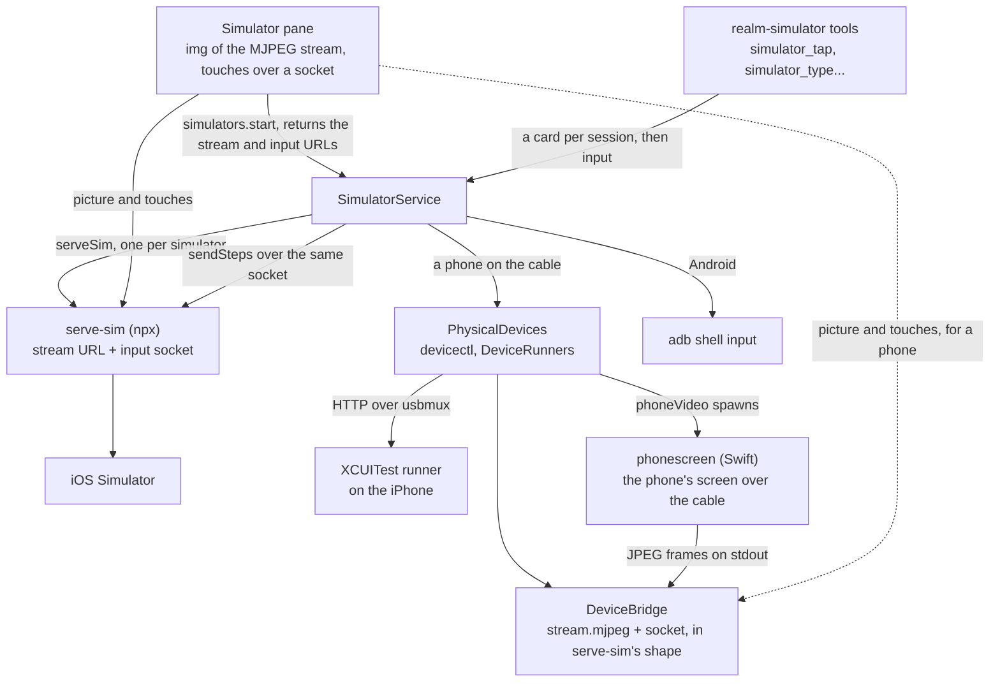

The accessibility tree an agent reads comes from serve-sim's `/ax` helper for a simulator, from the
runner on a phone, and from `uiautomator` on Android. Settings ▸ Lab reads whether this Mac is ready to
be left running (power, FileVault, disk, network) and which phones are on its cables.

**Key files**

- `apps/server/src/simulators/service.ts:SimulatorService`
- `apps/server/src/simulators/serve-sim.ts:serveSim`
- `apps/server/src/simulators/agent-tools.ts`
- `apps/server/src/simulators/physical.ts:PhysicalDevices`, `apps/server/src/simulators/device-runner.ts:DeviceRunners`, `apps/server/src/simulators/usbmux.ts:connectToDevice`
- `apps/server/src/simulators/device-bridge.ts:DeviceBridge`, `apps/server/src/simulators/phone-video.ts:phoneVideo`
- `apps/desktop/native/PhoneScreen.swift`, `resources/ios-device-runner/`
- `apps/desktop/src/renderer/src/panes/simulator/SimulatorPane.tsx`
- `apps/server/src/lab/service.ts:LabService`

## Notifications and Needs you

Needs you is not a feature of its own: it is every session whose status is `waiting_permission`, read
from the session rows. Notifications are kept by one service on the server that every other part
reports to (a permission, a finished session, a blocked run, a Connection that dropped, a budget
crossed). It writes the row and broadcasts `notifications.changed`. A window that is open but not in
front shows a macOS notification; with no window open, Electron main shows it from the tray. Three
kinds can also be relayed off the Mac, by iMessage through the `mac` CLI or by a Slack webhook, both
off until you set them.

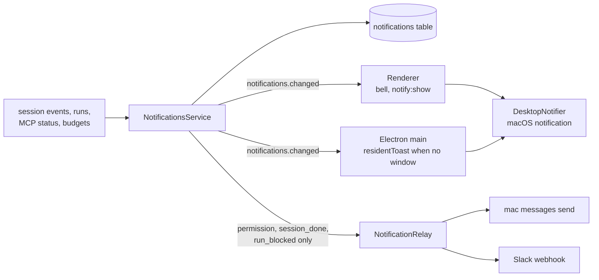

**Key files**

- `apps/server/src/notifications/service.ts:NotificationsService`
- `apps/server/src/notifications/relay.ts:NotificationRelay`
- `packages/contracts/src/notifications.ts:RELAYED_CATEGORIES`
- `apps/desktop/src/main/notify.ts:DesktopNotifier`
- `apps/desktop/src/renderer/src/components/sidebar/model.ts:needsYou`

## Mobile

The iPhone app is not in 2.3.0. It lives on the `feat/mobile` branch, 71 commits ahead of `main`, and
the paths in this section are on that branch. It is drawn here because it is built and talks to the
same server.

The phone never connects to the Mac directly. Both dial a relay, a Cloudflare Worker with one Durable
Object per Mac, which forwards ciphertext and never reads past a channel prefix. Pairing is a QR code
for `https://realm.computer/pair#...` carrying the Mac's public key and a one-time secret; the phone
and the Mac run a Noise `IKpsk1` handshake through the relay, and the Mac asks you before it trusts
the phone. Every connection after that is Noise `IK` against the pinned keys, and the channel carries
the `mobile.v1` calls, which the Mac maps onto the same RPC methods the desktop uses.

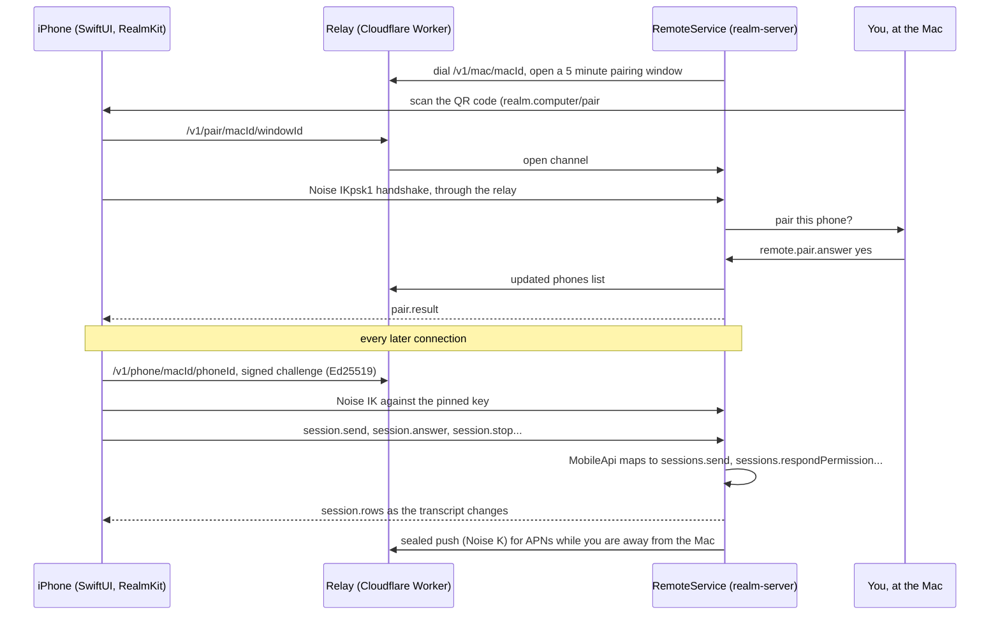

**Key files (on `feat/mobile`)**

- `packages/remote/PROTOCOL.md` (the wire protocol, version 1)
- `apps/server/src/remote/service.ts:RemoteService`, `apps/server/src/remote/gateway.ts:RemoteGateway`, `apps/server/src/remote/api.ts:MobileApi`
- `services/relay/src/durable.ts:MacRoom`, `services/relay/src/core.ts:RelayRoom`
- `apps/ios/Realm/AppModel.swift:AppModel`, `apps/ios/RealmKit/Sources/RealmKit/Channel/MobileConnection.swift:MobileConnection`
- `scripts/ios-release.mjs` (TestFlight, locally or through Xcode Cloud)

## Updates and releases

A release is cut on this Mac. `pnpm release` bumps the version, writes a changelog stub from the
merged pull requests, builds the dmg and zip with `latest-mac.yml` (signed and notarized when the
signing environment is loaded, unsigned otherwise), smoke-tests the packaged server, then commits and
tags locally. It never pushes or publishes; a person creates the
GitHub release from the printed steps. Installed copies check that release feed every four hours,
download in the background and ask before restarting. The updater refuses to run in development, off
macOS, and in any build that was not signed, because macOS cannot apply an unsigned update.

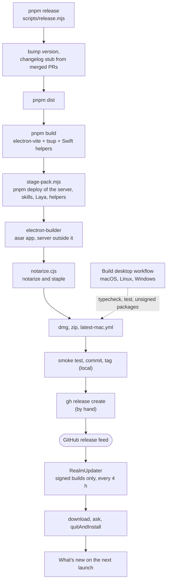

The server ships outside the asar under `Contents/Resources/server`, with its own production
`node_modules`, because `node-pty`'s native build and a spawnable entry cannot load from an archive.
`pnpm app:update` is the local loop: it builds an unpacked app and swaps it into `/Applications` with
a rollback. If the app bundle is replaced underneath a running copy, Realm notices the new asar and
relaunches rather than load from stale offsets. The website is separate: it is a Next.js app in
`site/`, outside the pnpm workspace, and its download button asks GitHub for the latest release's
dmg at render time.

**Key files**

- `scripts/release.mjs:release`
- `apps/desktop/scripts/stage-pack.mjs`, `apps/desktop/scripts/pack.mjs:packPlan`, `apps/desktop/scripts/notarize.cjs:notarizeDecision`
- `apps/desktop/electron-builder.yml`
- `apps/desktop/src/main/updater.ts:RealmUpdater`, `updaterDecision`, `scheduleUpdateChecks`
- `apps/desktop/src/main/whats-new.ts:WhatsNewState`
- `apps/desktop/src/main/bundle-swap.ts:asarReplaced`
- `scripts/app-update.mjs`, `scripts/install-local.mjs:installLocal`
- `.github/workflows/build-desktop.yml`
- `site/lib/release.ts:macDownload`
